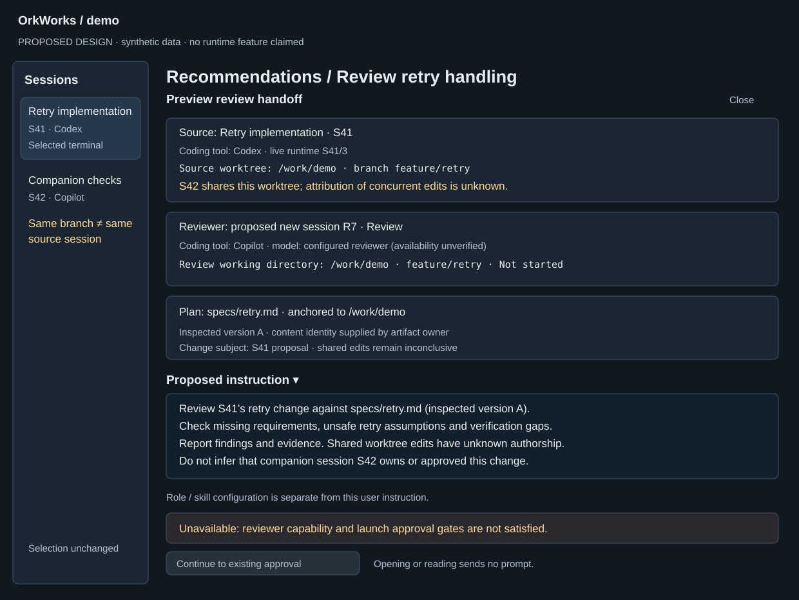
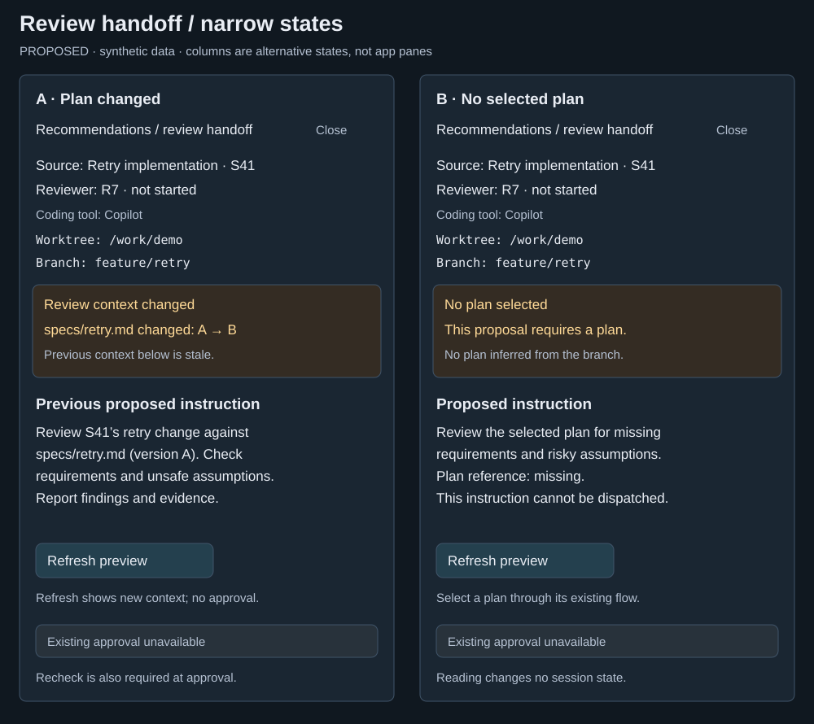

# Review handoff preview

Status: owner-accepted interaction design; no runtime implementation approval.
Tracking: [#1899](https://github.com/Rambolarsen/orkworks/issues/1899), within
[#610](https://github.com/Rambolarsen/orkworks/issues/610) and
[#746](https://github.com/Rambolarsen/orkworks/issues/746).
The owner authorized preparing this design and mockups on 2026-11-18.
The owner approved the full proposed design on 2026-11-18 with “go ahead”
after receiving draft PR #1905 and its review/validation handoff. This accepts
the interaction choices below, including in-place Recommendations detail, the
complete instruction expanded by default, and refresh before approval after
material context changes. Protocol qualification, adapter eligibility and the
scoped implementation plan remain separate gates.

## Intent and existing boundaries

Before approving a Taskmaster review, the user can inspect who will review,
which source session and work context the proposal concerns, which plan is
included, and the complete proposed instruction. Sharing a branch does not
make two sessions interchangeable. Reading this preview has no execution effect.

Use the existing Recommendations central surface and its recommendation detail,
with the existing Actions entry points. Do not add a review queue, separate
sidebar or shell destination. The current source's
`RecommendationsPanel.tsx` presents workflow-improvement recommendations;
this proposal is a future review-transition consumer, not a claim that its
reviewer-launch UI or backing protocol already exists.

Three operations remain distinct:

| Operation | Existing or proposed authority |
| --- | --- |
| Preview review handoff | Proposed read-only inspection; no selection, acknowledgement, acceptance or terminal input |
| Request independent review in central Review | Existing selected-live-session fixed prompt, revalidated by the sidecar; the source agent may delegate or review directly |
| Start a recommended reviewer / approve a child plan | Separately gated Taskmaster transition or exact-plan approval; no authority follows from this preview |

Preserve [Session Plan Review](../../../specs/session-plan-review.md),
[Taskmaster](../../../specs/taskmaster.md#coordinator-design-gate),
[the shell navigation contract](2026-10-05-application-shell-navigation-design.md)
and [hierarchy interaction](2026-10-04-agent-hierarchy-ui-design.md).
This proposal introduces no alternate fixed-prompt route or launcher.

## Placement and content

The recommendation offers **Preview review handoff**. Opening it expands the
recommendation detail in place and focuses its heading. Closing restores its
invoker, or the Recommendations heading if the card disappeared. The selected
ordinary session, terminal runtime, attention and unread state remain unchanged.

Show a short summary first; the complete instruction is expanded by default,
selectable and scrollable without truncation. Native disclosure may collapse
it after inspection. Never hide missing context behind the disclosure.

| Field | Presentation and provenance |
| --- | --- |
| Source | Session title plus distinguishable session identity; source tool and runtime state. Identity remains visible when titles match. |
| Reviewer | Proposed new session and role, coding tool and model as supplied by the owning proposal. If an existing reviewer is explicitly supported, show its exact session/runtime identity. Never infer one from branch or current selection. |
| Work context | Source effective worktree and branch, separate from the proposed review working directory/branch. Show unavailable, detached or not yet allocated explicitly; do not substitute the workspace root. |
| Plan/spec | Validated repository-relative artifact identity, anchored worktree and version/content identity as supplied by the artifact owner; or **No plan selected**, **Plan unavailable**, or **Plan changed**. |
| Instruction | Complete proposed user instruction and included artifact references; label role/skill configuration separately. This is not a promise to expose provider-internal prompts. |
| Readiness | Current, loading, changed or unavailable, plus the specific missing prerequisite. Independence and read-only permissions are claims only when supported by their contract owners. |

Use safe text rendering, existing validated artifact access and existing
role/configuration projections. Paths in the mockups are synthetic. Do not
expose absolute document paths through the selected-session artifact API,
read arbitrary files to populate the preview, or derive identity from prose.
A relative plan path alone is insufficient if sibling worktrees can contain
copies. Show the artifact owner's anchored identity; unavailable is truthful
when the consumer contract cannot provide it.

## Staleness and approval

The preview describes one inspected proposal, not a live authorization.
Loading and refresh preserve its identity and disable the consuming approval
until the new complete context is shown. Never mix fields from two refreshes.
This is a consumer requirement; concrete version tokens and transport must be
specified by the owning launch/artifact contracts before implementation.

1. On open, resolve the exact recommendation, source session/runtime, proposed
   reviewer configuration, source/reviewer locations and selected artifact in
   the current workspace/sidecar generation. No launch or acceptance request.
2. When any material input changes, mark **Review context changed**. Keep the
   inspected old values labelled as previous context, identify the changed
   field, and offer **Refresh preview**. Never silently replace the instruction
   while leaving an approval enabled. Returning to the same branch name or
   path does not prove the old snapshot current.
3. Refresh displays the complete new context and returns focus to the changed
   notice/heading. It grants no approval. Material edits through the eventual
   session composer likewise require a fresh preview of the edited proposal.
4. The consuming approval revalidates the exact displayed subject and inputs
   through its existing authenticated owner. A mismatch rejects before effects,
   returns to changed/unavailable, and requires inspection and another explicit
   approval. No automatic retry, fallback reviewer, resume or prompt submission.
5. A workspace switch, sidecar replacement or removed recommendation clears
   the preview and its pending approval state. Late responses cannot restore it.
   A source runtime replacement invalidates its live binding even if its title
   and branch are unchanged.

For ordinary session creation, the later #68 composer retains its explicit
**Start** action; preview does not accept or start the recommendation.
For an orchestrated child, keep the existing **Review exact proposal** route
and exact-plan approval. An individual task preview cannot authorize the plan
or create a separate launch button. Current gates may leave the consuming
action unavailable even while the preview can be read.

A missing plan is always visible. It blocks a plan-review proposal. A code-only
review may proceed only when its already-defined action contract permits no
plan and binds an explicit change subject; this design creates no optional-plan
exception. Missing reviewer, unresolved working location, unsupported capability
or missing exact-subject binding leaves the consuming action unavailable.
If the instruction includes artifact content, those exact bytes belong to the
inspected proposal. If it includes a path reference instead, label it as a
reference and revalidate its bound artifact before dispatch; this preview alone
does not promise immutable files after launch or qualify artifact custody.

## Synthetic mockups

These are proposed illustrations, not screenshots of shipped functionality.
The disabled continuation illustrates still-open launch gates, not a newly
implemented approval action.

The wide example keeps source S41 separate from companion S42 even though
both use `feature/retry` in `/work/demo`. Proposed reviewer R7 is **not started**.
The proposed instruction refers only to S41's selected plan and change subject;
S42 is context about shared work, not another source to infer or retarget.
Concurrent dirty activity remains inconclusive where attribution is unknown.

The second illustration shows an inspected plan changing from version A to B.
The old instruction remains visibly stale until refresh. The companion case
shows no selected plan rather than fabricating one from a branch name.

## Keyboard, narrow windows and accessibility

Use ordinary document order: heading, source, reviewer, work context, plan,
instruction, notices and existing next action. The preview is an in-page detail,
not a modal or focus trap. Close has an accessible name; Escape follows existing
Recommendations close behavior. Space/Enter on disclosure changes only visibility.

At narrow widths and 200% zoom, stack fields into one column, wrap paths and
instruction text, and let the central page scroll. Keep close, refresh, missing
state and action explanation reachable without horizontal page scrolling.
Session identities must remain distinguishable when labels wrap. Announce
changed/unavailable context through a polite status region, in text as well as
color; keep focus stable on asynchronous updates. A disabled action has an
adjacent readable explanation. Do not add motion or auto-focus the terminal.

## Implementation handoff and acceptance scenarios

After design acceptance, prepare a bounded implementation plan that identifies
existing read owners, exact coherent projection/version contracts and consuming
approval checks. Resolve any new IPC/schema or security design before dependent
code; the mockup is not a protocol. Preserve independent Electron/preload/renderer
types and sidecar authority. No production adapter eligibility is assumed.

| Scenario | Required observation |
| --- | --- |
| Two sessions share worktree/branch | Distinct source identities; no inferred reviewer or source substitution; unknown dirty-change attribution visible |
| Plan content changes at same path | Old preview marked changed; fresh coherent context and explicit approval required |
| Plan selection, pin or anchored worktree changes | Invalidate even if relative path or branch label is the same |
| Reviewer configuration or working directory changes | Invalidate instruction/approval context; no fallback |
| Missing/unreadable plan | Exact missing reason; plan-review action unavailable |
| Workspace/runtime replacement during read | Drop late response and invalidate pending live binding |
| Change between preview and approval | Authenticated owner rejects before any launch, Git effect or terminal input |
| Duplicate approval/retry | Preserve the consuming owner's existing idempotency and exact-plan rules; preview adds no execution path |
| Close or refresh by keyboard | Focus returns predictably; no selection, unread, acceptance or PTY effects |
| Narrow window, zoom and long text | All context, full instruction, notices and existing action remain readable/reachable |

Current deliverable is this accepted interaction contract and two static mockups. Product
runtime, artifact codecs, custody/storage, model selection policy, child launch,
new permissions, live model calls and installed settings are outside this task.
#1899 remains open for the subsequent gated implementation handoff.

## Scoped implementation plan

The [review-handoff preview plan](../plans/2026-11-18-review-handoff-preview.md)
traces current read/approval owners and proposes an isolated interactive
development slice. The owner accepted its fixture-only scope exception and tasks 1–3 on
2026-11-18 with “keep going” after the #1906 plan handoff. This is a separate
approval from the earlier hierarchy preview, not inherited authority.
Production recommendation/launch coherence and #610/#746 gates remain open.
The accepted interaction design above is unchanged.
